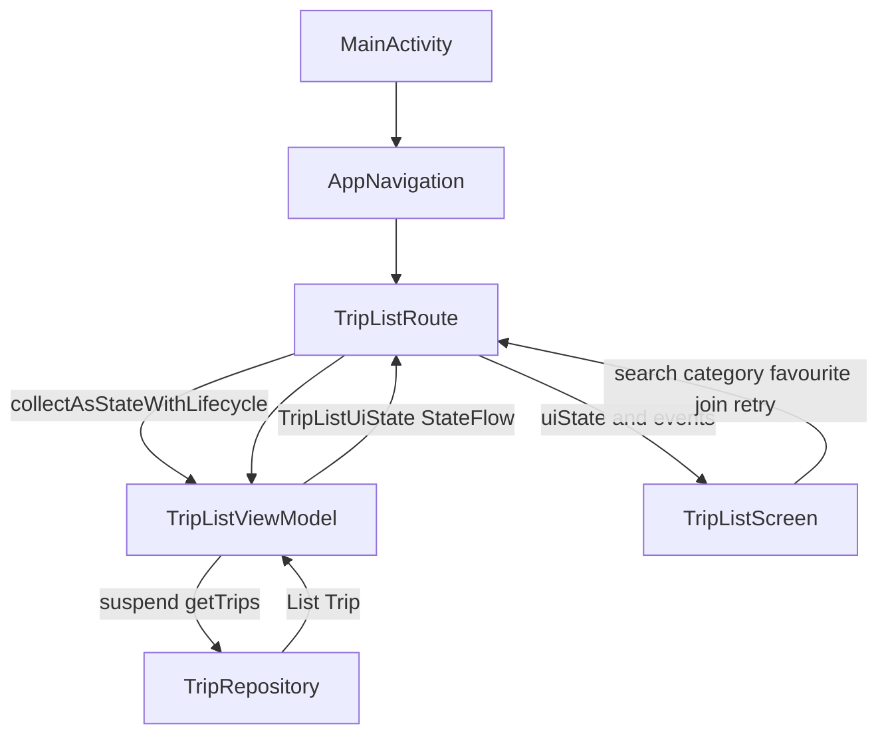

# KBTU Green Ecosystem

A Kotlin Android app prototype for greener travel and campus life at KBTU. The current implementation focuses on the Carpool/Trip flow and uses local sample data; no backend service or API credentials are required.

## Implemented screens

- **Trip List** — the start screen, with 12 sample rides, destination/driver search, category filters, and a friendly empty state.
- **Trip Details** — opened with a trip ID through Navigation Compose; shows the route illustration, pickup and destination, driver, available seats, CO₂ savings, a favorite toggle, and a local demo join action.
- **Profile** — sample student profile, EcoCoins, ESG rating, recent activity, and navigation back to Trips.

The app uses a custom green Material 3 theme with light and dark color schemes. The design sketches used as references are in [`design/`](design/), especially `carpool.png`, `trip_details.png`, `profile.png`, and `app_navigation.png`.

## Project structure

```text
app/src/main/java/com/example/ecosystem/
├── MainActivity.kt
├── data/
│   ├── TripRepository.kt
│   └── model/Trip.kt
└── ui/
    ├── components/
    │   ├── Icon.kt
    │   ├── SectionHeader.kt
    │   ├── TagChip.kt
    │   └── TripCard.kt
    ├── navigation/AppNavigation.kt
    ├── screens/
    │   ├── ProfileScreen.kt
    │   ├── TripDetailsScreen.kt
    │   ├── TripListScreen.kt
    │   └── TripListUiState.kt
    ├── viewmodel/TripListViewModel.kt
    └── theme/
        ├── Color.kt
        ├── Spacing.kt
        ├── Theme.kt
        └── Type.kt

app/src/main/res/drawable/trip_route.xml
```

## SIS4 MVVM architecture

The trip list is the main MVVM flow. `TripRepository` owns the local sample data and provides suspend loading with a short simulated delay. `TripListViewModel` owns filtering and user state; `TripListScreen` only renders the supplied state and calls event lambdas. `TripListRoute` connects the state holder to Compose using lifecycle-aware collection.



### UI state and event flow

`TripListUiState` is immutable and contains `trips`, `searchQuery`, `selectedCategory`, `favoriteTripIds`, `joinedTripIds`, `isLoading`, and `errorMessage`. `TripListViewModel` exposes it as a read-only `StateFlow`; search, category selection, favourite, join, and retry are handled by ViewModel methods. Loading, content, empty, and error states are represented by the same state model and have dedicated previews in `TripListScreen.kt`.

For example, typing a search query calls `onSearchChange(query)` from the screen event lambda. The ViewModel copies the state with the new query and filtered trips, and the Route observes the updated StateFlow. Filtering stays in `TripListViewModel`, so the screen remains a renderer. Query, category, favourites, and joined trips are held in the Activity-scoped ViewModel and survive configuration changes.

### Activity and ViewModel lifecycle check

`MainActivity` logs `onCreate`, `onStart`, `onResume`, `onPause`, `onStop`, and `onDestroy` under `SIS4Activity`. `TripListViewModel` logs `init` and `onCleared` under `SIS4ViewModel`. After launching the debug build in the `Medium_Phone` emulator and rotating twice, the filtered Logcat output was:

```text
10-19 07:56:28.734 D SIS4Activity: onCreate
10-19 07:56:28.952 D SIS4ViewModel: init
10-19 07:56:29.192 D SIS4Activity: onStart
10-19 07:56:29.217 D SIS4Activity: onResume
10-19 07:56:49.642 D SIS4Activity: onPause
10-19 07:56:49.655 D SIS4Activity: onStop
10-19 07:56:49.805 D SIS4Activity: onDestroy
10-19 07:56:49.851 D SIS4Activity: onCreate
10-19 07:56:49.880 D SIS4Activity: onStart
10-19 07:56:49.880 D SIS4Activity: onResume
10-19 07:56:52.756 D SIS4Activity: onPause
10-19 07:56:52.764 D SIS4Activity: onStop
10-19 07:56:52.824 D SIS4Activity: onDestroy
10-19 07:56:52.843 D SIS4Activity: onCreate
10-19 07:56:52.850 D SIS4Activity: onStart
10-19 07:56:52.851 D SIS4Activity: onResume
```

During a configuration change Android destroys and recreates the Activity to reload resources for the new orientation. The Activity-scoped ViewModel is retained by `ViewModelStore`, so its `init` is not repeated and `onCleared` is not called during those rotations. Its in-memory UI state therefore remains available to the new Activity instance. `onCleared` is expected when the Activity finishes or its ViewModel store is permanently cleared.

## Requirements

- Android Studio compatible with Android Gradle Plugin 9.3.2
- JDK 17 or newer
- Android SDK Platform 37
- Internet access for the first Gradle dependency sync

The project uses the Compose BOM declared in `gradle/libs.versions.toml`, Material 3, Material Icons Core/Extended, and Navigation Compose. Dependency versions are managed through the version catalog and BOM where applicable.

## Open and build

Clone the repository:

```bash
git clone https://github.com/Akedil02/Android_EcoSystem.git
cd Android_EcoSystem
```

1. Open the repository root folder in Android Studio (the folder containing `settings.gradle.kts`).
2. Select **File > Sync Project with Gradle Files** and wait for Gradle sync to finish. Install Android SDK Platform 37 if prompted.
3. Run the `app` configuration on an emulator or Android device.

Build a debug APK from the repository root:

```bash
# macOS / Linux
./gradlew :app:assembleDebug

# Windows PowerShell or Command Prompt
gradlew.bat :app:assembleDebug
```

Run local unit tests:

```bash
# macOS / Linux
./gradlew :app:testDebugUnitTest

# Windows PowerShell or Command Prompt
gradlew.bat :app:testDebugUnitTest
```

The debug APK is written to `app/build/outputs/apk/debug/app-debug.apk`.
