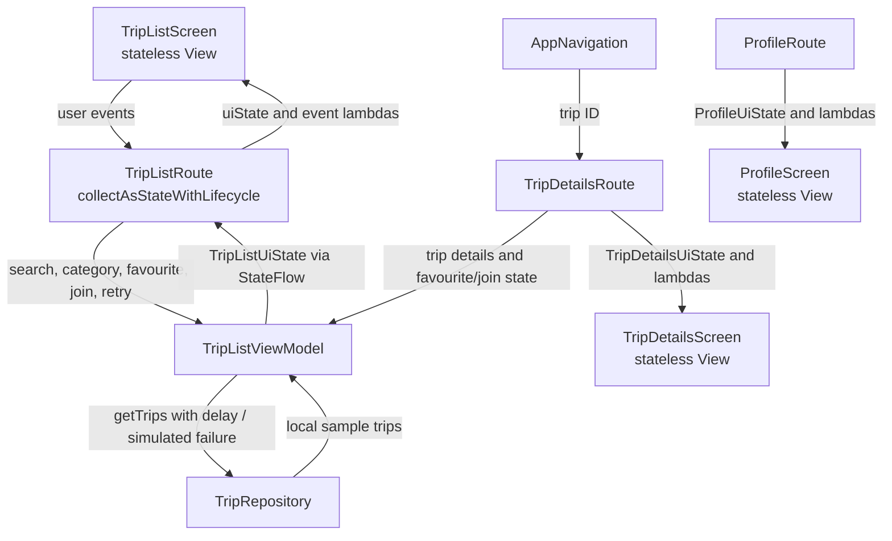

# SIS 4 Architecture Plan

## Screens and data flow

`TripRepository` owns the source list. `TripListViewModel` loads and filters it, handles screen events, and exposes immutable state. `TripListRoute` and `TripDetailsRoute` connect that state to stateless screens. Profile content is static sample data, passed to `ProfileScreen` as a `ProfileUiState`.

## TripListUiState

All properties are `val`:

- `trips`: currently visible trips after search and category filtering
- `searchQuery`: current search text
- `selectedCategory`: current filter
- `favoriteTripIds`: favourite IDs, retained by the ViewModel across rotation
- `joinedTripIds`: demo joined-trip IDs
- `isLoading`: whether the repository is loading
- `errorMessage`: non-null when loading failed

The four display cases are loading (`isLoading`), error (`errorMessage != null`), empty (`trips.isEmpty()` after a successful load), and content (`trips.isNotEmpty()`).

## Events

- `onSearchChange(query)`
- `onCategorySelected(category)`
- `onFavouriteClick(tripId)`
- `onJoinClick(tripId)`
- `onRetry()`

## Trace one click: searching trips

The user types in `TripListScreen`. Its `onSearchChange` lambda calls `TripListRoute`, which forwards the query to `TripListViewModel.onSearchChange`. The ViewModel filters its repository-loaded trips, updates `TripListUiState` with `copy(searchQuery = query, trips = results)`, and emits the new value through `StateFlow`. `collectAsStateWithLifecycle()` observes the update, and `TripListScreen` redraws the results or empty state without performing search logic itself.

## Loading and failure

`TripRepository.getTrips()` waits with `delay()` before returning local sample data. Its `shouldFail` flag can be enabled to throw a simulated load error. The ViewModel maps the exception to `errorMessage`; the screen shows the error state and Retry action. Retry repeats the repository request.
